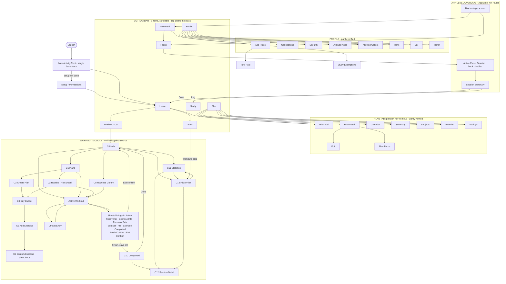

# FOCUS — NAV_MAP (navigation as implemented) + engineering plan

Status: workout module verified against source. Non-workout edges partly verified (marked). Build/test: NOT RUN.
Architecture: no NavHost. One back stack in `MainActivity.Root()` (`go()` / `back()`), `Screen` enum in `ui/Screens.kt`. Tab items clear the stack on tap. Workout screens render via `workout/WorkoutHost.kt`; shared state in `WorkoutNav`.

## 1. Map of the app as implemented

Stack rules: C1, C8, C10, C11 and the C12 list appear at most once on the stack. A push equal to the current screen is ignored. Starting a workout always yields `[C0, Active]`; finishing yields `[C0, C10]`.

## 2. Differences vs the intended Mermaid diagram

| # | Difference | Type |
|---|---|---|
| 1 | App bar has 8 items; diagram has 6 (and is titled "five tabs") | Decision |
| 2 | Plan tab exists in app, absent from diagram | Decision |
| 3 | Time Bank is a tab in app, a Home sub-destination in diagram | Decision |
| 4 | Splash / Onboarding / Sign Up / Log In have no routes (only Setup) | Decision |
| 5 | Study flow (Session, Question, Result, Log), Goals, Achievements, Body Stats, Export, About: not verified | Unverified |
| 6 | Diagram has C4 → C6; app reaches C6 via C5 (sheet) | Minor, retained |

## 3. Plan
- **Step 0, decide (product owner):** recommend keeping Plan and Time Bank as tabs and updating the diagram (removing them deletes working features); decide whether auth/onboarding is real or should be dropped from the diagram.
- **Step 1, freeze:** this file is the single source of truth.
- **Step 2, verify (read-only):** walk Focus, Study, Profile click paths and mark each edge verified/missing.
- **Step 3, fix only real defects, one change per edge**, stating the edge, the back destination, and tab-vs-push behaviour.

Rules for engineers: (1) no new `Screen` without a map update; (2) nested states stay dialogs/sheets; (3) never `back(); go()` to replace a screen, reset to the intended base; (4) anything that saves needs a double-tap guard and idempotent save; (5) report NOT RUN when it is.

Acceptance: every node has an entry point; Back lands where the map says; start→exit from every entry returns to C0; no screen twice on the stack.
